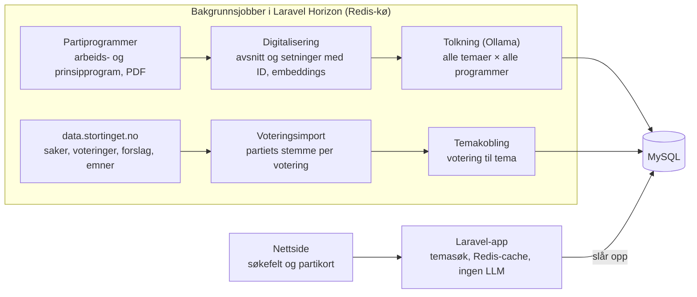

# Designdokument: HvaMenerPartiet

Sist oppdatert 25.10.2026 · Lars Åge

## Formål og omfang

HvaMenerPartiet lar en velger søke på et tema, for eksempel «NATO», og se på én skjerm hva hvert parti mener, med et kort utdrag fra partiprogrammet og lenke til kilden. Partiprogrammet er hovedkilden. Stemmegivning på Stortinget er en sekundær, tydelig merket kilde fordi den er vanskeligere å tolke.

**Første versjon dekker:**

- De ni partiene på Stortinget etter valget i 2025: Ap, FrP, H, SV, Sp, Rødt, MDG, KrF og V.
- Arbeidsprogrammene for perioden 2025–2029 og partienes gjeldende prinsipprogram, vist hver for seg.
- Fritekstsøk på tema, med standpunkt per parti og et utdrag på maks 2–3 setninger.

**Senere:** flere partier (for eksempel INP, PF, Pensjonistpartiet), eldre programmer for å vise endring over tid, og voteringsanalyse.

**Ikke i omfang:** en valgomat som anbefaler parti, eller tolkning av hva partiene «egentlig» mener utover det de skriver og stemmer.

## Eksisterende løsninger

Jeg fant ingen norsk tjeneste som i dag viser standpunkt per parti på et fritt valgt tema med utdrag fra programmet. De nærmeste forbildene er tyske KI-verktøy fra valget i 2025 og britiske TheyWorkForYou for stemmegivning. Valgomater er utelatt.

| Løsning | Land | Kilde | Hva brukeren får | Forskjell fra HvaMenerPartiet |
| --- | --- | --- | --- | --- |
| [Electify](https://pycon.de/archive/2025/talks/electify-retrieval-augmented-generation-for-voter-information-in-the-2024-european-election/) | Tyskland, EU | Partiprogrammer, RAG | KI-sammendrag av hvert valgt partis posisjon på et spørsmål, med sidelenke og mulighet for å skjule partinavn | Nærmest vår idé, men fritekstsvar uten fast standpunktskala. Åpen kildekode på GitHub |
| [wahl.chat](https://www.zdfheute.de/politik/deutschland/alternative-wahl-o-mat-100.html) | Tyskland | Partiprogrammer, RAG | Chat med opptil tre partier, korte svar med lenke til programmet | Samtale, ikke en oversikt over alle partier. Bruker også nyhetskilder |
| [qahl-der-wahl](https://www.hessenschau.de/politik/bundestagswahl/real-o-mat-wahlswiper-und-co-vier-alternativen-zum-wahl-o-mat-2025-v4,btw25-real-o-mat-100.html) | Tyskland | Partiprogrammer, KI | Svar på egne eller 760 ferdige spørsmål | Ferdige spørsmål ligner vår temaliste, men uten visuell sammenligning |
| [Real-O-Mat](https://www.hessenschau.de/politik/bundestagswahl/real-o-mat-wahlswiper-und-co-vier-alternativen-zum-wahl-o-mat-2025-v4,btw25-real-o-mat-100.html) | Tyskland | Faktisk stemmegivning i Bundestag | Sammenligner brukerens syn med hvordan fraksjonene stemte | Kritisert for å vise koalisjonens vedtak heller enn partienes syn, akkurat tolkningsproblemet vi må håndtere |
| [TheyWorkForYou](https://www.theyworkforyou.com/mp/24854/sajid_javid/bromsgrove/votes) | Storbritannia | Voteringer i parlamentet | Stemmegivning gruppert per politikkområde («consistently voted for»), med forbehold om fravær og parring | Per representant, ikke per parti. God modell for hvordan voteringer kan oppsummeres med forbehold |
| [Holder de ord](https://GitHub.Com/jarib) | Norge | Stortingets voteringer og partiprogrammer | Fulgte partienes løfter og stemmegivning, blant annet visualisering av partienes enighet på Stortinget | Norsk forgjenger. Ser ikke ut til å være aktiv i dag, men koden ligger på GitHub (holderdeord) |
| [Manifesto Project](https://en.wikipedia.org/wiki/Manifesto_Project_Database) | Over 50 land | Kodede partiprogrammer siden 1945 | Forskningsdatasett, ikke en forbrukertjeneste | Nyttig for å validere vår klassifisering mot manuelt kodede data |

I tillegg lager interesseorganisasjoner temaoversikter før valg, for eksempel [YS](https://ys.no/wp-content/uploads/2025/08/Hva-mener-partiene-og-YS.pdf) og [Greenpeace](https://www.greenpeace.org/static/planet4-norway-stateless/2025/05/e953ecfe-greenpeace-velgerguide-2025.pdf). De dekker bare egne temaer, men viser at behovet finnes.

**Lærdom vi tar med:** Electify fant at strengere instruks om å avstå fra svar ga omtrent 99 % trofasthet mot kilden, men lot rundt 15 % av spørsmålene stå ubesvart. Det støtter at vi viser «Ikke omtalt» heller enn å gjette. Real-O-Mat viser at voteringer må presenteres med tydelige forbehold. Om Holder de ord sin status er en antakelse; den bør sjekkes.

## Brukeropplevelse

Brukeren skriver et tema og får ett kort per parti med en farget standpunktmerkelapp, et utdrag og en kildelenke. Kortene sorteres etter standpunkt, slik at for og mot står samlet.

**Standpunktskala** (fast, lik for alle temaer):

| Merkelapp | Betydning | Eksempel (NATO) |
| --- | --- | --- |
| For | Programmet støtter tydelig | «Norge skal være et aktivt NATO-medlem» |
| Delvis for | Støtter med vilkår eller forbehold | Støtter medlemskap, men vil ha mindre alliert aktivitet i nord |
| Mot | Programmet går tydelig imot | Vil melde Norge ut av NATO |
| Delt / uklart | Omtaler temaet, men standpunktet kan ikke leses entydig | Teksten peker i flere retninger, mer informasjon trengs |
| Ikke omtalt | Programmet sier ingenting om temaet | Ingen treff i programmet |

«Ikke omtalt» og «Delt / uklart» holdes adskilt. Det første betyr at partiet tier, det andre at teksten finnes men er tvetydig.

**Hvert partikort viser:**

1. Partinavn, logo-farge og standpunktmerkelapp.
2. Utdrag på maks 2–3 setninger fra arbeidsprogrammet, alltid ordrett sitert, og en egen linje «Prinsipielt syn» fra prinsipprogrammet.
3. Lenke rett til de siterte setningene i det digitaliserte programmet.
4. En sikkerhetsindikator (høy / middels / lav) og «Vis mer» med flere relevante avsnitt.
5. Valgfritt, i egen fane: «Slik stemte partiet» med voteringer knyttet til temaet og en tydelig tolkningsadvarsel.

**Søkehjelp:** autofullføring mot en temaliste («NATO», «EU», «bompenger», «eiendomsskatt»), synonymer («forsvarsallianse» gir NATO) og forslag til relaterte temaer. Søket treffer bare temaer som allerede er analysert. Finnes ikke temaet, vises nærmeste treff og en knapp for å foreslå det. Hvert resultat har en knapp for å melde fra om feil klassifisering.

## Datakilder

To kilder er nødvendige: partiprogrammene (PDF fra partienes nettsider) og Stortingets åpne data for voteringer.

| Kilde | Innhold | Format | Oppdatering |
| --- | --- | --- | --- |
| Partiprogrammer | Arbeidsprogram for stortingsperioden og prinsipprogram, ett av hver per parti | PDF, av og til HTML | Arbeidsprogram hvert fjerde år, prinsipprogram sjeldnere |
| [data.stortinget.no](https://data.stortinget.no) | Saker, emner, voteringer, voteringsforslag og resultat per representant | Åpent API, XML og JSON | Fortløpende i sesjonen |
| Partiregister | Partinavn, forkortelse, farge, nettside | Manuelt vedlikeholdt fil | Ved behov |

**Partiprogrammer:** lastes ned manuelt eller med et enkelt skript, lagres med URL, nedlastingsdato og en hash av filen. Originalfilen beholdes alltid, slik at hvert utdrag kan spores tilbake til side og avsnitt.

**Stortingsdata:** eksport-API-et gir blant annet saker per sesjon, emneord per sak, voteringer per sak, forslagstekstene det ble stemt over, og hvordan hver representant stemte. Partiets stemme utledes fra representantenes stemmer. Vilkår for bruk av API-et og partienes opphavsrett til programmene bør sjekkes før publisering, men korte sitater med kildehenvisning er normalt uproblematisk.

## Arbeidsprogram og prinsipprogram

Hvert program klassifiseres for seg, og partikortet viser begge: arbeidsprogrammet gir hovedmerkelappen, prinsipprogrammet vises som en egen linje «Prinsipielt syn». De svarer på ulike spørsmål: hva partiet vil gjennomføre i perioden, og hva partiet mener på lang sikt.

| Programtype | Tidsperspektiv | Typisk innhold | Rolle i løsningen |
| --- | --- | --- | --- |
| Arbeidsprogram | Én stortingsperiode, 4 år | Konkrete tiltak og forslag | Hovedmerkelapp og utdrag |
| Prinsipprogram | Langsiktig, revideres sjeldnere | Verdier, ideologi og overordnede mål | Egen linje med eget utdrag og vedtaksår |

**Regler for visning** (fast logikk i koden, ikke en LLM-vurdering, slik at den er lett å forklare):

| Arbeidsprogram | Prinsipprogram | Visning |
| --- | --- | --- |
| Omtaler temaet | Samme retning eller ikke omtalt | Merkelapp fra arbeidsprogrammet, prinsipprogrammets utdrag under «Vis mer» |
| Ikke omtalt | Omtaler temaet | Merkelapp fra prinsipprogrammet, tydelig merket «fra prinsipprogrammet» |
| Omtaler temaet | Motsatt eller annen retning | Begge merkelapper side om side, med merknaden «Langsiktig mål avviker fra planen for perioden» |
| Ikke omtalt | Ikke omtalt | «Ikke omtalt» |

Avvik mellom de to er nyttig informasjon og skal ikke slås sammen til «Delt / uklart». Et eksempel er et parti som prinsipielt vil ut av en organisasjon, men som ikke vil arbeide for utmelding i denne perioden.

**Praktiske hensyn:**

- Kombinerte dokumenter (Sp, trolig FrP) har prinsippdel og handlingsdel i samme PDF. Oppdelingen merker hvert avsnitt med del, ut fra overskriftene, og delene klassifiseres hver for seg som om de var to programmer. Er skillet uklart, merker LLM-en hvert avsnitt, og en person kontrollerer merkingen én gang per dokument.
- Prinsipprogrammer kan være flere år gamle. Vedtaksåret vises alltid, og det gjeldende programmet er det som brukes.
- Voteringer sammenlignes med arbeidsprogrammet, fordi det er det partiet har lovet å jobbe for i perioden.
- Brukeren kan filtrere visningen til bare arbeidsprogram eller bare prinsipprogram.

**Programsituasjonen per parti** (fra kildelisten i prosjektfilene, sjekket 25.10.2026):

| Parti | Arbeidsprogram 2025–2029 | Prinsipprogram | Håndtering |
| --- | --- | --- | --- |
| Ap | Ja | Ingen gjeldende | Bare arbeidsprogram, «Prinsipielt syn» vises som «ingen prinsipprogram» |
| FrP | Kombinert dokument | Del av samme dokument (ikke bekreftet) | Deles i prinsipp- og handlingsdel |
| H | Ja | 2019 | To dokumenter |
| SV | Ja | 2023 | To dokumenter |
| Sp | Kombinert prinsipp- og handlingsprogram | Del av samme dokument | Deles i prinsipp- og handlingsdel |
| Rødt | Ja | 2019 | To dokumenter |
| MDG | Ja | Ja, vedtaksår ukjent | To dokumenter, vedtaksår må finnes |
| KrF | Ja | 2023 | To dokumenter |
| V | Ja | 2020 | To dokumenter |

Et parti uten prinsipprogram vises som «ingen prinsipprogram», ikke som «Ikke omtalt», så det ikke ser ut som partiet tier om temaet.

## Digitalisering av programmene

Hver PDF gjøres om til et strukturert dokument der hvert kapittel, avsnitt og setning har en fast ID og egen lenke. Et standpunkt peker da på nøyaktig de setningene det bygger på, og brukeren kommer rett dit med én klikk.

**Lenkeformat:** programmene publiseres som lesbare sider på nettstedet, for eksempel `/program/sv/arbeidsprogram-2025/kap-4#a12-s3-s5`. Lenken åpner kapittelet, ruller til avsnitt 12 og markerer setning 3 til 5. Sidetallet i originalen vises ved siden av, med lenke til PDF-en (`#page=47`) som reserve.

**Fremgangsmåte:**

1. **Tekstuttrekk med posisjon:** `pdftotext -bbox-layout` (poppler) gir hvert ord med side, posisjon og skriftstørrelse.
2. **Struktur:** overskrifter gjenkjennes på skriftstørrelse, fet skrift og nummerering. Topptekst, bunntekst og sidetall fjernes, og orddeling over linjeskift slås sammen.
3. **Setningsdeling:** regelbasert deling med en liste over norske forkortelser (f.eks., bl.a., jf., nr., ca.), så punktum i forkortelser ikke deler setninger.
4. **Faste ID-er:** nummerering per kapittel, avsnitt og setning, pluss en hash av teksten. Ved ny import av samme dokument beholdes ID-ene der teksten er uendret, slik at gamle lenker virker.
5. **Kontroll i Filament:** PDF-siden og den digitaliserte teksten vises side om side. Eieren kan rette overskrifter, slå sammen eller dele avsnitt og merke prinsipp- eller handlingsdel, før dokumentet godkjennes.
6. **Videre bruk:** først etter godkjenning lages embeddings og kjøres klassifisering.

Modellen får avsnitt med setnings-ID-er og svarer med hvilke setninger som støtter standpunktet. Utdraget hentes så fra de setningene i databasen, ikke fra modellens egen tekst, så sitatet er alltid ordrett.

Første versjon digitaliserer bokmålsutgaven. Nynorskutgavene kan legges til senere som parallelle dokumenter.

## Arkitektur

Løsningen bygges i Laravel med MySQL, Redis og Laravel Horizon. All analyse skjer i bakgrunnsjobber på forhånd, og nettsiden gjør aldri LLM-kall: et søk slår bare opp ferdige, kontrollerte standpunkter. Det gjør søket raskt, kostnaden forutsigbar og hvert resultat mulig å kvalitetssikre før det vises.



*Alle standpunkter lages på forhånd, søket slår bare opp.*

Et tema som ikke finnes, gir ingen live-analyse. Brukeren ser nærmeste eksisterende temaer og kan foreslå temaet. Forslaget går til godkjenning og klassifiseres i neste kjøring av bakgrunnsjobben.

**Komponenter:**

- **Innsamling:** Artisan-kommandoer og jobber som henter PDF-er og Stortingets data, med versjonering av hver fil. Laravel scheduler starter voteringsimporten ukentlig.
- **Tekstbehandling:** `pdftotext` (poppler) via Laravels Process, digitalisering til kapitler, avsnitt og setninger med faste ID-er, og embeddings fra en embedding-modell i Ollama.
- **Klassifisering:** én jobb per program og tema på en egen Horizon-kø med rate limiting og nye forsøk ved feil. Ollama kjører på egen server, helst med GPU, og køen begrenses til så mange samtidige jobber som serveren tåler.
- **Database:** MySQL. Embeddings lagres som binære vektorer og brukes bare i bakgrunnsjobben. Med noen tusen avsnitt per parti kan likhet regnes i PHP uten egen vektordatabase. Brukersøket bruker MySQL FULLTEXT på temanavn og synonymer.
- **Redis:** kø for Horizon og cache for ferdige temasider.
- **Nettside:** Laravel med Blade og Livewire, med de digitaliserte programmene som egne sider, server-rendret for rask første visning og god søkemotorindeksering av temasidene.
- **Admin:** FilamentPHP for å godkjenne temaer, kontrollere standpunkter og behandle tilbakemeldinger.

## Analysemetode

Standpunkt settes i to steg: først finnes de relevante avsnittene i hvert program, deretter vurderer en språkmodell bare de avsnittene. Modellen får aldri svare fra egen kunnskap om partiet, kun fra teksten den får.

1. **Oppdeling:** de digitaliserte avsnittene brukes direkte, og korte avsnitt under samme overskrift slås sammen til biter på 200–600 ord for søket. Hvert avsnitt beholder parti, år, side og overskriftssti («Forsvar > NATO og allierte»).
2. **Temadefinisjon:** hvert tema får et navn, en kort beskrivelse, synonymer og en påstand som standpunktet måles mot. For NATO: «Norge bør være medlem av NATO». Uten en slik påstand er «for» og «mot» udefinert.
3. **Gjenfinning:** likhetssøk med embeddings kombinert med søk på nøkkelord og synonymer, de 5–10 beste avsnittene per parti. Et parti uten treff over terskelen får «Ikke omtalt» uten LLM-kall.
4. **Klassifisering:** ett LLM-kall per program og tema, arbeidsprogram og prinsipprogram hver for seg, returnerer strukturert JSON med standpunkt, begrunnelse, sikkerhet og ID-ene til setningene som støtter det.
5. **Kontroll av kilder:** koden sjekker at setnings-ID-ene finnes og hører til riktig program. Utdraget bygges fra disse setningene, maks 2–3, og er dermed alltid ordrett.
6. **Konsistens:** kjør klassifiseringen 2–3 ganger eller med to modeller. Uenighet gir «Delt / uklart» eller manuell gjennomgang.
7. **Manuell kvalitetssikring:** eieren godkjenner hvert tema og hvert standpunkt i Filament før publisering. Brukerrapporter om feil går til samme kø.

**Eksempel på svar fra modellen:**

```json
{
  "standpunkt": "mot",
  "sikkerhet": "høy",
  "kildesetninger": ["rodt-ap2025-k7-a3-s2", "rodt-ap2025-k7-a3-s3"],
  "begrunnelse": "Programmet sier eksplisitt at Norge bør forlate NATO."
}
```

**Valg av modell:** all tolkning kjører lokalt via Ollama. En instruksjonsmodell med god norsk brukes til klassifisering og temaforslag, og en flerspråklig embedding-modell (for eksempel bge-m3) til søk. Hvilken instruksjonsmodell velges ved å måle kandidater mot testsettet. Ollamas format-parameter med JSON-skjema gir strukturerte svar. Med ni partier, to programtyper og 300 temaer blir det rundt 5 400 klassifiseringer per programperiode, noe som er rimelig å kjøre på nytt når metoden forbedres.

**Måling av kvalitet:** lag et testsett på rundt 100 tema–parti-par klassifisert for hånd, og mål treffsikkerhet hver gang prompt eller modell endres.

## Stemmegivning på Stortinget

Voteringer vises som et supplement, aldri som grunnlag for standpunktmerkelappen. En stemme sier hva partiet gjorde i en bestemt situasjon, ikke nødvendigvis hva det mener.

**Hvorfor stemmer er vanskelige å tolke:**

- Partier stemmer mot forslag de er enige i fordi forslaget kom fra et annet parti, eller fordi de har et eget forslag.
- Regjeringspartier og budsjettpartnere er bundet av avtaler.
- Det stemmes ofte over hele innstillinger eller budsjettrammer der mange temaer er blandet.
- Mange forslag «vedlegges protokollen» eller avvises uten at innholdet er det egentlige skillet.
- Fravær og parring kan se ut som manglende støtte.

**Metode:**

1. Hent saker med emneord, voteringer, forslagstekster og stemme per representant fra data.stortinget.no.
2. Regn ut partiets stemme per votering (flertallet av partiets representanter) og marker der partiet stemte splittet.
3. Koble voteringen til tema via Stortingets emneord og en LLM-vurdering av forslagsteksten.
4. La LLM-en avgjøre om forslagsteksten faktisk tar stilling til temaets påstand, og i hvilken retning. Bare slike voteringer regnes som «relevante».
5. Vis forslagsstiller og om partiet var i regjering eller budsjettsamarbeid den gang.

**Visning:** «Slik stemte partiet» er en egen fane med liste over relevante voteringer, dato, forslagsteksten kort og partiets stemme. En samlet oppsummering kan vise «stemte i tråd med programmet i 7 av 9 relevante voteringer», alltid med lenke til hver enkelt votering.

**Mulig senere funksjon:** «Samsvar mellom program og stemmegivning» per parti. Den bør først bygges når tolkningen er testet godt, fordi den lett kan oppfattes som en karakter på partiene.

## Administrasjon og godkjenning

All godkjenning skjer i et admin-panel bygget med FilamentPHP, og ingenting vises på nettsiden før eieren har godkjent det.

**Godkjenningsflyt:**

1. Et program lastes opp, digitaliseres, og eieren kontrollerer og godkjenner strukturen.
2. LLM-en foreslår temaer ut fra programmenes overskrifter og innhold. Eieren godkjenner, slår sammen eller redigerer påstand og synonymer.
3. Klassifisering kjøres for hvert godkjent tema mot alle godkjente programmer. Eieren godkjenner, korrigerer eller avviser hvert standpunkt.
4. Godkjente standpunkter publiseres. En ny import eller en ny promptversjon sender berørte standpunkter tilbake til godkjenning.

| Filament-side | Hva eieren gjør |
| --- | --- |
| Partier | Legger til og redigerer partier |
| Programmer | Laster opp PDF, starter digitalisering, ser status |
| Digitaliseringskontroll | Ser PDF og digitalisert tekst side om side, retter overskrifter, avsnitt og prinsipp- eller handlingsdel |
| Temaer | Godkjenner LLM-forslag, redigerer påstand og synonymer, starter klassifisering |
| Standpunkter | Arbeider seg gjennom en kø med de siterte setningene markert, godkjenner, endrer merkelapp eller kildesetninger, eller avviser |
| Voteringskoblinger | Godkjenner hvilke voteringer som hører til et tema |
| Tilbakemeldinger | Behandler «Meld fra om feil» og åpner standpunktet det gjelder |
| Jobber | Ser status for kjøringer, med lenke til Horizon-dashbordet |

Med rundt 5 400 standpunkter er manuell godkjenning mye arbeid for én person. Køen sorteres derfor med lav sikkerhet og uenighet mellom kjøringer først. «Ikke omtalt» og standpunkter der to kjøringer er enige med høy sikkerhet kan godkjennes samlet etter stikkprøver.

## Datamodell

Datamodellen skiller kilde, tema og vurdering, slik at et standpunkt alltid kan spores til avsnittet det bygger på og til hvilken modell og prompt som laget det.

| Tabell | Viktige felter | Kommentar |
| --- | --- | --- |
| parti | id, navn, forkortelse, farge, nettside, aktiv\_fra, aktiv\_til | Nye partier legges til her uten kodeendring |
| program | id, parti\_id, type (arbeidsprogram / prinsipprogram / kombinert), periode, vedtatt\_år, gjeldende, språk, kilde\_url, filhash, lastet\_ned, digitalisering\_status | Arbeidsprogram per periode, prinsipprogram per vedtak. Status: lastet opp, digitalisert, godkjent |
| kapittel | id, program\_id, nr, tittel, overordnet\_kapittel\_id, slug | Gir lenker som `/program/sv/arbeidsprogram-2025/kap-4` |
| avsnitt | id, kapittel\_id, nr, del (prinsipp / handling), side, tekst, tekst\_hash, embedding | Embedding som binær vektor (BLOB), brukes bare i bakgrunnsjobben |
| setning | id, avsnitt\_id, nr, tekst, tekst\_hash | Minste enhet et standpunkt kan peke på |
| tema | id, navn, beskrivelse, påstand, synonymer, overordnet\_tema\_id, status | Foreslås av LLM, godkjennes av eier. Status: foreslått, godkjent, analysert, publisert |
| standpunkt | id, tema\_id, program\_id, verdi, sikkerhet, begrunnelse, modell, prompt\_versjon, status, godkjent\_av, godkjent\_tid | Status: maskinell, godkjent, korrigert, avvist |
| standpunkt\_kilde | standpunkt\_id, fra\_setning\_id, til\_setning\_id | Setningene som støtter standpunktet. Utdraget bygges fra disse |
| sak | id, stortinget\_id, sesjon, tittel, emneord | Fra data.stortinget.no |
| votering | id, sak\_id, dato, forslagstekst, forslagsstiller, vedtatt | En sak kan ha mange voteringer |
| partistemme | votering\_id, parti\_id, for, mot, fravær, partiets\_stemme | Avledet fra representantenes stemmer |
| votering\_tema | votering\_id, tema\_id, relevant, retning, begrunnelse, status | LLM-vurdert kobling, godkjennes i Filament |
| tilbakemelding | id, standpunkt\_id, tekst, opprettet, behandlet | Fra «Meld fra om feil» |

Standpunktverdien er en fast liste: for, delvis\_for, mot, delt\_uklart, ikke\_omtalt.

## Utvidbarhet, nøytralitet og risiko

Et nytt parti legges til ved å registrere partiet, laste opp programmet og kjøre bakgrunnsjobben. All logikk er lik for alle partier, så ingen kode endres.

**Utvidelser som modellen allerede støtter:**

- Flere partier, også små partier uten stortingsplass.
- Eldre programmer, slik at man kan se hvordan et partis syn har endret seg.
- Andre kilder som kommunevalgprogram eller landsmøtevedtak, merket som egen kildetype.

**Risiko og tiltak:**

| Risiko | Konsekvens | Tiltak |
| --- | --- | --- |
| Feil klassifisering | Partiet fremstilles feil, tillit svekkes | Ordrett sitat med kilde, sikkerhetsindikator, manuell kontroll av viktige temaer, «Meld fra om feil» |
| Skjevhet mellom partier | Tjenesten oppfattes som partisk | Samme prompt for alle, testsett med jevn fordeling, blind manuell kontroll uten partinavn |
| Ledende temapåstand | Standpunktet avhenger av hvordan påstanden er formulert | Nøytral formulering, publiser påstanden sammen med resultatet |
| Feiltolkning av voteringer | Partiet ser ut til å være mot noe det støtter | Egen fane, forbehold, forslagsstiller og regjeringsstatus vises |
| Opphavsrett til programtekst | Krav fra parti | Korte sitater med kildehenvisning, lenke til originalen |
| Temaet brukeren søker på er ikke analysert | Brukeren får ikke svar | Bred temaliste fra start, synonymer, «Foreslå tema» som mates inn i neste kjøring |

Tjenesten bør ha en offentlig metodeside som forklarer skalaen, prompten og kjente svakheter.

## Trinnvis fremgangsmåte

Start med et lite bevis på at klassifiseringen er god nok, før det bygges nettside. Hvert trinn har et tydelig kriterium for å gå videre.

1. **Prototype på ett tema.** Last ned arbeidsprogram og prinsipprogram for de ni partiene, del dem opp og klassifiser «NATO» og 4–5 andre temaer med en Artisan-kommando. *Videre når:* resultatene stemmer med en manuell vurdering.
2. **Testsett og metode.** Klassifiser rundt 100 tema–parti-par for hånd, juster prompt og gjenfinning, mål treffsikkerhet. *Videre når:* treffsikkerheten er høy nok (forslag: minst 90 %) og «Ikke omtalt» sjelden er feil.
3. **Temaliste og database.** Digitaliser programmene og godkjenn strukturen i Filament. La LLM-en foreslå 100–300 temaer med nøytrale påstander og synonymer, og godkjenn dem, sett opp Laravel med MySQL, Redis og Horizon, og kjør hele bakgrunnsjobben.
4. **Nettside, første versjon.** Søkefelt, partikort, digitaliserte programsider med setningslenker og «Meld fra om feil». Kun forhåndsberegnede temaer.
5. **Manuell kontroll og lukket test.** Gå gjennom de viktigste temaene og test med 10–20 brukere med ulikt politisk ståsted.
6. **Temaforslag.** Brukerne kan foreslå temaer. Godkjente forslag klassifiseres i neste planlagte kjøring, kontrolleres og publiseres.
7. **Voteringsanalyse.** Importer data fra data.stortinget.no, bygg temakobling og vis «Slik stemte partiet» som egen fane.
8. **Flere partier og perioder.** Legg til små partier og eldre programmer.

**Forslag til teknologi:**

| Del | Valg | Merknad |
| --- | --- | --- |
| Rammeverk | Laravel | Artisan-kommandoer for import, jobber for analyse |
| Database | MySQL | FULLTEXT for temasøk, embeddings som BLOB |
| Kø og cache | Redis med Laravel Horizon | Egne køer for import, embeddings og klassifisering, med rate limiting |
| Planlegging | Laravel scheduler | Ukentlig voteringsimport, kjøring av godkjente temaforslag |
| PDF til tekst | poppler `pdftotext` via Process | -bbox-layout gir side, posisjon og skriftstørrelse til strukturgjenkjenning |
| LLM | Ollama med strukturert JSON-svar | Lokal kjøring, ingen API-kostnad. Modellen velges ved måling mot testsettet |
| Embeddings | Embedding-modell i Ollama med god norsk støtte, f.eks. bge-m3 | Treffer synonymer som «forsvarsallianse» |
| Frontend og admin | Blade med Livewire, FilamentPHP for admin | Server-rendrede temasider |

**Avklarte spørsmål:**

- Skal tjenesten være åpen kildekode, slik Electify er?
  - Ja, lisensiert under MIT-lisens
- Hvem gjør manuell kvalitetssikring, og trengs et redaksjonelt ansvar før publisering?
  - Eier gjør manuell godkjenning av hvert tema
- Skal temalisten lages manuelt, eller foreslås av en LLM ut fra programmenes overskrifter og godkjennes manuelt?
  - Foreslås av LLM

**Kilder:** [Electify (PyCon DE 2025)](https://pycon.de/archive/2025/talks/electify-retrieval-augmented-generation-for-voter-information-in-the-2024-european-election/) · [ZDFheute om wahl.chat](https://www.zdfheute.de/politik/deutschland/alternative-wahl-o-mat-100.html) · [ifun.de om wahl.chat](https://www.ifun.de/wahl-chat-ki-gespraeche-mit-den-wahlprogrammen-246720/) · [hessenschau om Real-O-Mat m.fl.](https://www.hessenschau.de/politik/bundestagswahl/real-o-mat-wahlswiper-und-co-vier-alternativen-zum-wahl-o-mat-2025-v4,btw25-real-o-mat-100.html) · [TheyWorkForYou](https://www.theyworkforyou.com/mp/24854/sajid_javid/bromsgrove/votes) · [Holder de ord på GitHub](https://GitHub.Com/jarib) · [Manifesto Project](https://en.wikipedia.org/wiki/Manifesto_Project_Database) · [data.stortinget.no](https://data.stortinget.no)
